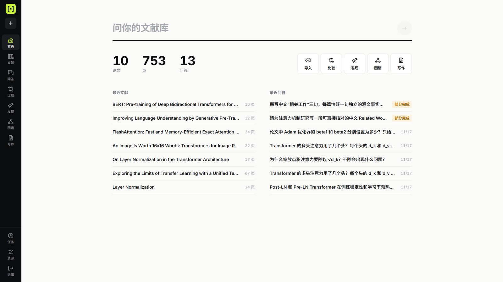
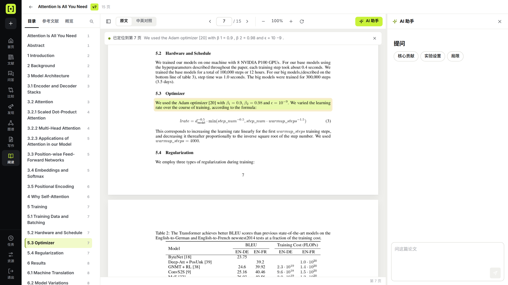
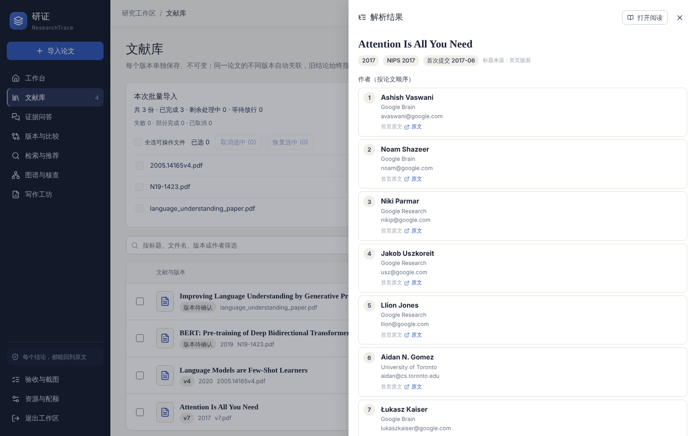
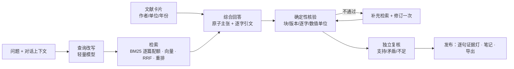
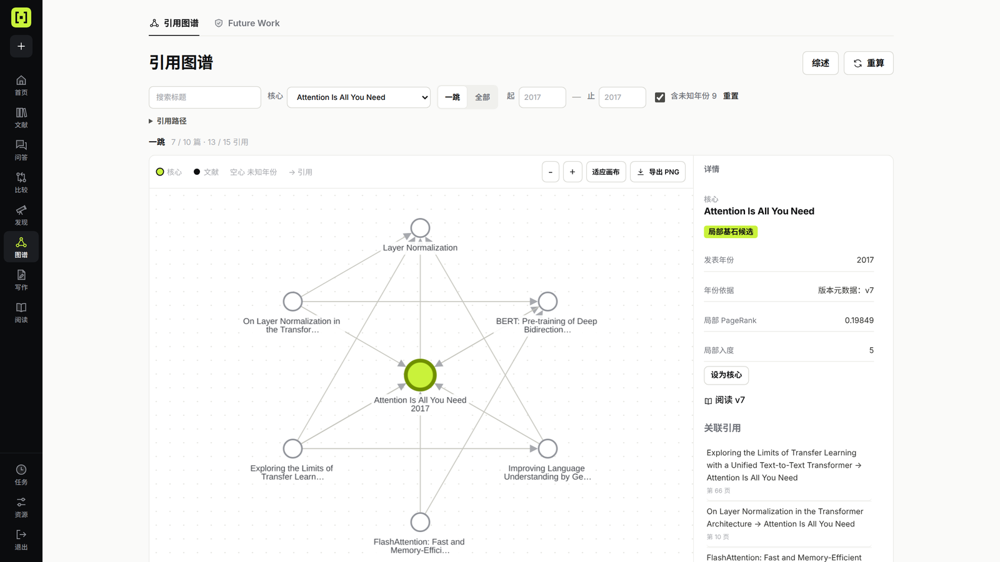

# 研证 ResearchTrace

**每个结论都能回到原文的科研智能体。** 导入论文、提出问题，回答中的每一句都绑定具体论文版本、页码和原文片段，并经过数值、版本与语义复核；查不到就明确写“证据不足”。

参赛方向：第九届传智杯 AI 大模型创新应用挑战赛 · 科研小助手 Agent。赛题、评分与交付清单见 [START_HERE.md](START_HERE.md)，当前执行计划见 [docs/REFACTOR_PLAN.md](docs/REFACTOR_PLAN.md)，测试证据见 [docs/TEST_REPORT.md](docs/TEST_REPORT.md)。

**2026-11-17 当前代码**：`upgrade/complete-20261116`，继承 Claude 分支增量开发。公网入口 [researchtrace.sluna.xyz](https://researchtrace.sluna.xyz)。本地 Nemotron 检索优先，完整39份/23,185向量已部署；645项后端测试、前端构建通过。80题中75道有答案题的重排标准证据全部进入前20，独立人工审阅仍待完成，不能等同问答准确率。最新交接见 [COMPLETION_20261117.md](docs/COMPLETION_20261117.md)。

正式演示视频和技术PDF由团队自行制作、审阅与提交；仓库内现有材料仅作参考。代码推送不等于赛事提交，未关闭的质量门槛和GitHub账户CI计费锁仍如实保留。



## 它解决什么问题

科研助手最常见的失效是：答案看起来对，但无法核对；同一论文的不同版本被混用；旧论文里的 Future Work 被当成今天仍没人做过的方向。研证把这些都落实到可以点击检查的对象上：

- **逐句证据灯**：回答拆成原子主张，每条显示“已核对支持 / 待复核 / 与原文矛盾 / 证据不足”，点开即是逐字原文和页码，一键跳到 PDF 高亮位置。错误前提（例如“为什么用了 80 张 GPU”）会被原文纠正。
- **版本感知**：按内容（arXiv 编号、正文指纹）识别同一论文的不同版本，即使文件名随机；提示保留较新版本，展示差异，并指出哪些已保存结论需要在新版本中复核。旧结论永远指向原版本。
- **Future Work 核查**：从旧论文的建议出发检索后续文献，按时间与条件给出“已有直接证据 / 部分覆盖 / 当前范围证据不足”，不写“全球首次”。



## 六类功能

| 模块 | 能做什么 | 入口 |
|---|---|---|
| 文献管理与解析 | 批量上传（单次最多 20 篇，逐文件进度、取消与恢复）；SHA256 去重与版本识别；原生文字、扫描 OCR（PaddleOCR / MinerU 可选）、541 页长书逐页检查点；**文献卡片**：标题、按顺序的作者与单位和邮箱、发表年份、会议、摘要、分级目录、表格/图/公式/参考文献计数、附录起始页 | 文献库 → 解析结果 |
| 知识问答 | 单篇与多篇问答；多轮对话（“其中…”可省略论文名）；中文问题自动改写为英文检索查询，逐篇检索后融合；每句绑定原文并复核 | 证据问答 |
| 阅读与翻译 | PDF.js 原版阅读；按 PDF 书签生成的分级目录（如 3.2.2 Multi-Head Attention）；正文引用与参考文献往返；段落/整页/全文英译中与中译英，按段落对齐双向滚动；Markdown/HTML 导出 | 阅读 |
| 检索与推荐 | arXiv 与 Crossref 检索、按标题/DOI/arXiv ID 入库；追踪查询与定时检查；点赞/不感兴趣影响排序 | 检索与推荐 |
| 图谱与综述 | 由真实参考文献条目构建局部引用图，计算局部 PageRank、入度，按年份筛选，点击边看到原文引用；Future Work 核查 | 图谱与核查 |
| 写作与绘图 | 有出处的研究笔记与比较；CSV 计算统计后生成折线/柱状/雷达/三维图与数据驱动的图注、复现脚本；可编辑 Mermaid 结构图；导出 Markdown/HTML/BibTeX | 写作工坊 |



## AI 技术要点



- **文档智能**：不可变的版本 / 解析快照 / 文本块（含页码与坐标）；按字号聚类识别小型大写标题；用 PDF 书签生成分级目录；首页版面经一次轻量模型配对作者与单位，**模型给出的每个字符串都必须在原文中出现，否则丢弃**。
- **检索增强**：FTS5 BM25（中英对称分词）+ 可选本地向量模型（Nemotron / Qwen 8B，独立索引代际、原子激活）+ RRF + 重排；多篇比较时每篇保底配额；元数据类问题直接带入作者所在原文块。
- **多角色、有边界的智能体**：路由与改写、检索、综合、确定性核验、独立复核分角色执行；最多一次修订、明确的调用上限；每一步写入可公开的执行记录，界面实时展示，不展示或编造隐藏思维链。
- **模型调度**：按角色配置模型链（深度分析 Gemini 4 Hydrogen → 3.6 Flash → 3.5 Flash Lite）；只有在本地额度拒绝或上游明确报错时才换下一个模型，状态不明的请求绝不重发；界面标出实际回答的模型和降级。配额按项目、按太平洋时区日计账，失败与未知请求同样计入，付费兜底默认关闭。
- **安全**：下载做 DNS 固定与逐跳 SSRF 校验；工作区隔离贯穿文件、任务和产物；上传内容只作为数据，不能成为指令；绘图只执行固定模板，不运行模型生成的代码。



## 运行

### 本地开发

```bash
python3.12 -m venv .venv && .venv/bin/pip install -r requirements.lock
cp .env.example .env && chmod 600 .env   # 设置访问码；有授权时填写模型密钥
(cd apps/web && npm ci && npm run build)
./scripts/dev.sh                           # http://127.0.0.1:18970
```

没有模型密钥时，导入、解析、阅读、检索、图谱和绘图仍可使用，问答与翻译显示“模型未配置”。

### 轻量部署（约 2 核 2 GB）

```bash
docker compose --profile lite up -d --build
RT_DOMAIN=demo.example.org docker compose --profile lite --profile https up -d   # 自动 HTTPS
```

包含 API、文档处理与交互两个 worker 池（长文解析不阻塞问答）和可选的 Caddy 自动证书。Docker Hub 受限时可设置 `RT_IMAGE_REGISTRY=mirror.gcr.io/library/`。模型、预算与评审配置见 [.env.example](.env.example)，部署细节见 [docs/DEPLOYMENT.md](docs/DEPLOYMENT.md)。

### 测试

```bash
./scripts/test.sh      # 后端单元/集成测试、静态检查、前端类型检查与构建、OpenAPI 导出
```

## 项目结构

```
apps/web/            React + TypeScript + Vite 前端（路由、设计系统、阅读器、证据问答）
services/api/        FastAPI：文档解析、检索、模型调度、核验、智能体、图谱、绘图
services/worker/     持久化任务的两个执行池
services/parsing/    可选的 MinerU / PaddleOCR 解析服务
services/retrieval_runtime/  可选的本地向量与重排服务（GPU 主机）
tests/               单元与集成测试
evals/               检索评测题集与测试 PDF
docs/                技术文档、测试报告、决策记录
```

## 诚实边界

- 测试数量不是回答准确率；质量评测的分子分母与失败样例见 [docs/EVALUATION.md](docs/EVALUATION.md) 与 [docs/TEST_REPORT.md](docs/TEST_REPORT.md)。
- 引用图谱的中心性只针对当前导入的文献集合，不代表领域权威。
- 机器复核“支持”不等于数学证明，界面保留人工核对入口。
- BM25、RRF、PageRank、PDF.js 与各模型均为第三方方法或服务，归属见 [THIRD_PARTY_NOTICES.md](THIRD_PARTY_NOTICES.md)；本项目的贡献在于版本—证据—主张的可追溯机制与工程集成。

## 团队

> 由参赛团队填写：成员、分工与联系方式。

## 测试数据

[四份核心测试 PDF](evals/pdfs/core/README.md)（Transformer v1/v7、扫描版、541 页《Understanding Deep Learning》）与[完整资料包](evals/pdfs/科研小助手/README.md)。

### 2026-11-17 增量开发

继续Claude分支的版本选择、参考文献、阅读器划词、写作图谱、云检索与ECS部署，详见[当前实施状态](docs/COMPLETION_20261117.md)。[公网入口](https://researchtrace.sluna.xyz)已验证HTTPS及独立评审登录；模型启用和完整索引以实际状态为准。项目仍有未关闭的发布门槛，不宣称正式提交完成。

[技术PDF（6页）](deliverables/ResearchTrace_技术说明.pdf) · [实际界面演示（6分钟1080p普通话）](deliverables/ResearchTrace_实际界面演示_1080p.mp4)。演示中的历史任务不冒充实时生成；参赛要求、AI35/工程30/创新15/体验10/实用10评分和新Agent任务入口见[START_HERE](START_HERE.md)。
