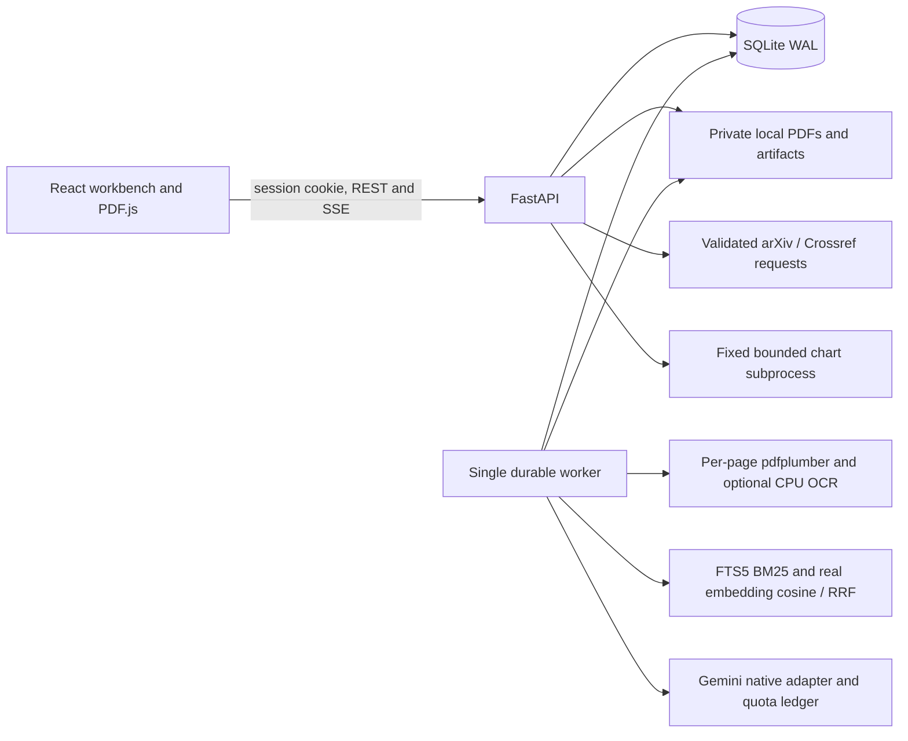

# ResearchTrace architecture

The implementation is a CPU-first document workbench. React/TypeScript/Vite builds a static frontend; FastAPI serves it and authenticated REST/SSE APIs. One durable Python worker processes PDF parsing, analysis, translation and idea audits. SQLite WAL and local files are the source of truth. There is no Redis, vector service, local LLM or GPU requirement.

## Contract and persistence

`packages/contracts/API.md` describes the contract; FastAPI-generated OpenAPI is the executable schema source. `services/api/store.py` applies an idempotent schema migration. Core records are workspace, work, immutable document version, physical page, coordinate-bearing block, parsed reference, citation edge, run, ordered step, claim, evidence, translation, artifact, quota reservation, provider state and watch query. Retrieval currently indexes blocks directly; it does not maintain a separate chunk hierarchy. Provider configuration comes from server environment, not browser settings.

A research work can have multiple retained PDF versions. SHA256 detects identical uploaded bytes. Content front matter provides arXiv/DOI identities and version evidence; uncertainty stays explicit. Every quoted evidence item contains the original version ID, block ID, zero-based physical page, normalized visible-page bbox and quote. Printed labels are separate. Existing answers keep their original version IDs when another version is imported. Deleting a document removes it from new accessible retrieval; old artifacts must not imply that deleted original evidence remains available.

PDF processing commits each page and checkpoint before continuing. Native text and region coordinates use pdfplumber; low-text pages use available Tesseract OCR via page rasterization. Source figure/table regions remain inspectable when reconstruction is unreliable. The reader mounts one PDF page at a time. `parsed_pages` and `dense_pages` are distinct; failed embedding does not become completed hybrid indexing.

Embeddings are stored as float32 BLOBs with model and dimension. Query vectors and document vectors must have matching model/dimension. Keyword and dense candidate lists remain observable, and RRF combines their ranks. Dense failure returns a labelled keyword mode. It does not substitute generated or cached model answers.

## Execution and recovery

`jobs.queue` atomically checks workspace/idempotency key and persists a queued run. Reuse with a different payload is rejected. The queue is bounded to six pending runs per workspace and thirty globally. `services.worker.main` holds a process lock, claims one queued run and dispatches a fixed, bounded workflow; this is not an arbitrary-shell agent. Analysis plans retrieval, synthesis, citation validation and artifact persistence. Watch checks have their own persisted runs and remain disabled until enabled.

Runs and ordered public tool events survive restart. SSE reconnect reads persisted event IDs, without resubmitting the expensive action. Worker restart requeues interrupted running jobs and marks unresolved reservations unknown. PDF/translation checkpoints skip completed pages/blocks. Model responses are checkpointed before citation validation. A crash between an upstream response and durable response storage can still leave an unknown charged request; manual review is safer than claiming a refund. Cancellation prevents subsequent model calls; an already submitted upstream request may still incur usage.

Citation validation checks permitted block identity and normalized literal quote containment; source facts require evidence. `located_semantics_pending` is deliberately distinct from semantic support. The system does not claim that an existing citation proves a statement. Current semantic judgement remains model-assisted and subject to human review.

## Models and budgets

The active adapter uses Gemini native `generateContent` and `batchEmbedContents`. Hydrogen is the configured core analyzer; Flash Lite handles translation and routine processing. The provider page exposes redacted configuration, locally recorded usage and uncertainty, never provider keys. The ledger reserves project/model RPM, input TPM and Pacific-date RPD transactionally before sending HTTP requests. Failed/unknown requests remain counted. Different credentials with the same project label do not create extra capacity. Global Hydrogen smoke budget defaults to four calls; workspace budget is separate. There is no active paid fallback or unlimited repair loop.

Input reservation currently uses a conservative UTF-8 byte upper estimate plus overhead, not an official tokenizer count. Limits are conservative application configuration/snapshot assumptions, not a real-time official remaining-balance query. Other applications sharing a quota project are outside this local ledger. OpenAI-compatible and MiniMax production routing are not active in the initial implementation.

## Boundaries and resource design

Workspace session authorization applies to documents, runs, translations, graphs and artifacts. Login codes and provider credentials remain server-only. The API adds same-origin write checks, CSP and HttpOnly/SameSite cookies; production enables secure cookies under HTTPS. Untrusted documents and model text never receive host tool permissions. External fetches validate every redirect, resolve all addresses, reject nonpublic targets and pin the actual connection to a validated IP with original TLS SNI. Chart rendering only executes a fixed template with validated data; model/CSV text is never Python source.

Compose declares 512MiB for API and 896MiB for worker; these are configured ceilings, not measured performance. Long PDFs stream page by page, embedding batches have bounded bytes/counts, and chart processes have address-space/CPU/time/file limits and a secret-free environment. The final test report is authoritative for measured memory, concurrency, browser checks and remaining gaps. Broad untrusted-PDF sandboxing, a remote worker protocol and multi-host SQLite operation are not implemented.
